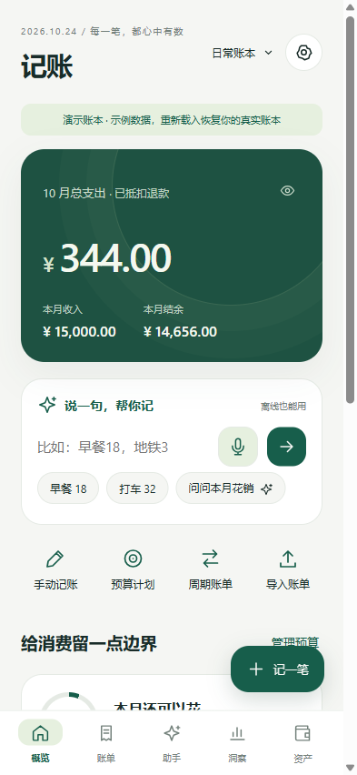
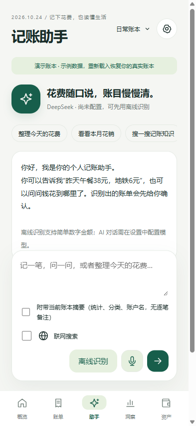
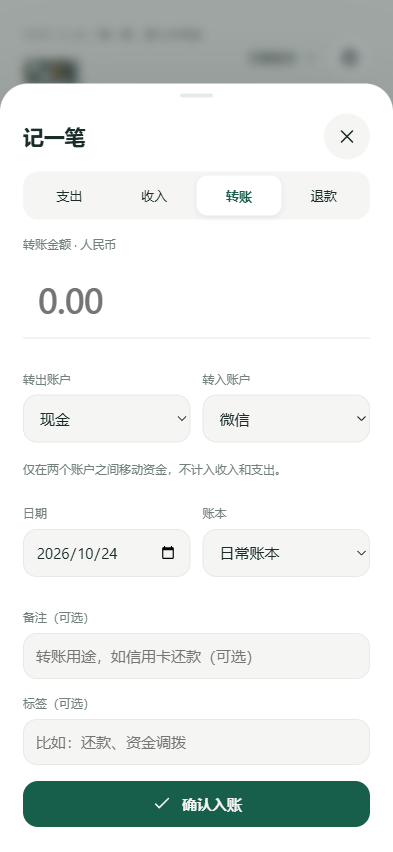

# 记账

免登录、以自然语言和待确认账单为中心的个人 Android 记账助手。人民币日常收支优先，账本保存在手机本机。

当前交付 **0.1.1 个人预览版**，支持 **Android 8.0 / API 26 及以上**。安装文件为 `outputs/记账_0.1.1_预览版.apk`。

**[下载安卓 APK](https://github.com/taonian1989-hub/jizhang-android/releases/tag/v0.1.1-preview.1)** · **[版本说明](CHANGELOG.md)** · **[使用说明](docs/使用说明_v1.md)**

  

以上为 APK 同一套界面资源的浏览器移动预览，使用明确标记的演示数据，不是真机截图。

本版新增首页与助手语音输入，并按支出、收入、转账、退款切换对应字段。原版可沿用同一签名覆盖升级，无需卸载；升级前可先导出JSON备份。

## 开始使用

1. 将 APK 传到手机，按 Android 提示允许所选来源安装。打开即可记账，没有注册、登录或订阅墙。
2. 在资产页设置已有账户的期初余额。信用卡期初欠款填负数。
3. 在概览输入“早餐18，地铁3”，查看待确认卡片，检查金额、分类和账户，再确认入账。
4. 设置 → 模型连接，填写 DeepSeek、Kimi、GLM 或自定义兼容接口的模型 ID、HTTPS 对话地址和自己的 API Key。保存后可测试连接。
5. 需要搜索时先配置 GLM 官方接口和 Key，然后在助手中主动勾选“联网搜索”。搜索与对话模型可以不同。
6. 定期在设置 → 数据备份与导入导出完整 JSON。卸载或清除应用数据前务必备份。

详细说明见 [使用说明](docs/使用说明_v1.md)，验证范围见 [验收记录](docs/验收记录_v1.md)。

## 功能

| 功能 | 本版行为 |
| --- | --- |
| 自然语言记账 | 简单中文语句在本机解析，复杂语句可交给所配置的模型；候选卡片确认后才入账 |
| 手动记账 | 四种类型动态字段、账户及分类；转账不展示或保存消费分类，隐藏字段不参与校验 |
| 语音输入 | 首页与助手均有麦克风入口，系统识别、可停止或取消；文字回填后由用户检查再发送或识别 |
| AI 助手 | 流式回复、停止、连续追问、当前月份统计摘要分析；默认不附带财务摘要 |
| 联网搜索 | 独立 GLM Web Search；显示来源和失败状态；不自动读取网页全文 |
| 账单 | 月份、类型筛选，关键词、金额、备注和标签搜索，编辑、删除及重复提醒 |
| 多账户 | 期初余额、资产账户、信用账户、账户间转账和净资产；账户余额汇总全部账本 |
| 多账本与分类 | 分账本统计、预算；共用账户余额和分类；账本重命名、自定义分类 |
| 预算 | 各月份独立的总预算与分类预算，已用、剩余与超支显示 |
| 洞察 | 分类净支出、六个月趋势、自然日平均支出和月结余 |
| 周期账单 | 月度、年度计划，到期后需手动确认；月底日期自动夹到有效日期 |
| 储蓄目标 | 目标金额、累计已存进度；独立记录，不移动资金、不增加收入 |
| 数据 | 加密原子保存、JSON 备份恢复、固定格式 CSV 导入导出与去重、读取失败时只读保护 |
| 体验 | 暖白墨绿、深色与跟随系统、隐藏金额、移动底部导航、大屏侧边导航、减少动效和系统字体缩放 |

金额以整数分计算。消费统计为支出减退款，转账和信用卡还款不计入消费。分类净退款不计入正向占比，趋势图负净支出显示为零。

## AI 接口和隐私

应用不提供模型或搜索额度，服务商按其规则计费。预设模型 ID 为可编辑起点，不保证所有账号都有调用权限。支持 Chat Completions SSE 和 JSON 响应，不提供 Responses 或 Anthropic 协议适配。

Android 安装版的账本和密钥分别通过 Android Keystore / AES-GCM 加密。写入采用 AtomicFile；读取失败会暂停写入，避免覆盖原数据。应用禁用系统自动备份，无自建服务器和遥测。申请网络权限，并在主动使用语音输入时申请麦克风权限；文件导入和导出走系统文件选择器，不申请存储全盘访问。

调用模型会发送当前对话、设备日期、当前账户 ID/名称及分类。主动勾选“附带当前账本摘要”后，额外发送当前账本所选月份的收支、分类、预算和记录数；不附带逐笔备注，也不发送完整历史账单。切换到其他服务商时清空当前对话。联网搜索发送本次输入的前128个Unicode字符到 GLM，搜索摘要再提供给对话模型。不要在搜索词或聊天中输入 API Key、银行卡号等敏感内容。

密钥读取接口仅返回是否已保存。修改对话地址需重新填写 Key；携带密钥的 HTTP 请求不跟随重定向、不自动重试。自定义代理密钥不能拿去调用官方搜索。浏览器预览禁用真实密钥配置，只使用本地浏览器存储，不能代表 Android 加密存储验证。

语音由Android系统服务提供；Android 12及以上有可用本地服务时优先使用，本地中文包不可用时尝试系统默认服务，必要时打开系统语音窗口。系统服务可能联网处理音频，本应用不保存录音、不将音频发给所配置的大模型。取消、切换页面或应用进入后台会结束当前录音；最终文字只回填，不自动发问或记账。

**导出的 JSON/CSV 是明文，不包含密钥。** 备份不包含聊天内容。卸载、清除数据、设备损坏或密钥失效可能导致本地记录不可恢复，需用户主动导出备份。应用内示例账本为只读展示，不写入真实账本；重新载入恢复。

## 当前边界

本版没有银行自动同步、支付代扣、后台自动记账、截图 OCR、图片附件、多人云同步、多币种换算或系统通知。首页和助手可点麦克风输入，系统需有可用语音服务；没有服务时可用输入法的语音键。周期账单是应用内待办，实际付款和入账都由用户确认。

CSV 仅支持本应用导出的固定列格式，不直接兼容微信、支付宝或银行原始流水。导入时需预先建立对应名称的账本、账户和分类。JSON 恢复前显示预览，确认后替换本地数据；CSV 确认后追加并跳过重复项。

容量边界：30000笔账单、100账户、50账本、100分类、200周期计划、200储蓄目标；快照约600万UTF-16单元，文件导入最大32MB。手机可用空间可能使实际容量更低。AI 对话保留最近20条，草稿需要确认入账，不跨重启保留。

## 构建与验证

Java Android 宿主 + 随 APK 打包的 HTML/CSS/JS，运行期无需第三方前端包或线上网页。默认提供 Windows PowerShell 构建工具。

```powershell
pwsh -File scripts/provision_android.ps1
pwsh -File scripts/build_apk.ps1
node tests/ledger_test.cjs
pwsh -File scripts/test_protocol.ps1
node scripts/serve_preview.cjs
```

协议测试首次运行会下载固定版本的 JVM org.json 测试依赖并校验 SHA256；不打入 APK。已有工具链可传 `-ToolRoot`，其中包含 `jdk/<JDK目录>`、`platform/android-35` 和 `build-tools/android-15`。

也可在 Android Studio 中打开项目，使用 JDK17、SDK35、AGP8.9.2 和 Gradle8.11.1；源码包没有 Gradle wrapper。预览 APK 使用本项目 `work/signing/personal-preview.keystore` 签名，源码包不含私钥。同签名升级才能保留数据，请保管该文件。

界面脚本通过 Playwright CLI 的 `run-code --filename` 运行，不是 Playwright Test spec。先启动本机8803端口预览，设置393×852视口；`tests/ui_smoke.js`、`tests/ai_edges.js` 与 `tests/voice_and_forms.js` 需分别使用全新浏览器会话，AI和语音脚本仅注入测试用桥。界面测试会清空测试会话的预览数据，不要用于存有真实记录的浏览器会话。

## 目录与验收

```text
app/src/main/java/   宿主、加密快照、密钥、模型客户端、搜索与提示词
app/src/main/assets/ 本地界面、金额和账本业务逻辑
app/src/main/res/    原创矢量图标与Android主题
scripts/            构建、工具链、协议验证与预览服务
tests/              金额、协议和移动界面检查
docs/               产品定义、使用、验收与依据
outputs/            APK、源码、说明、截图与校验文件
work/               构建、签名、日志和中间文件，不随源码交付
```

验收要求为可编译且签名有效的 APK、无登录的本机记账闭环、准确转账退款规则、备份预览与恢复、模型和搜索协议校验、移动和大屏界面流程。已完成本机验证，**没有使用真实模型Key，也没有连接真机或实际麦克风**；不宣称完成真机或实网联调。界面截图来自同一套资源的浏览器预览，使用明确标注的演示数据。语音回填与表单切换等共222项本地检查通过，实际系统语音服务及录音权限弹窗仍待真机验证。

本地业务、界面、图标和账本加密快照为本项目新增；模型传输、密钥存储、受限 WebView 与构建工具复用用户已有项目中的 MIT 代码，保留许可声明。项目以 MIT 许可证公开发布，预览版不等同于完成真实 Key 和真机联调。
